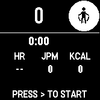
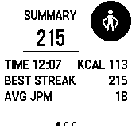
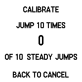

# Rope Jumps

A jump rope counter for the Garmin Instinct E 40 mm. It counts jumps from wrist motion, keeps track of sets and rest, and saves the workout as a Jump Rope activity in Garmin Connect.

It runs on the watch. No phone or network is needed during a workout.

**Free on the Connect IQ Store:** [apps.garmin.com/apps/63739fad-a779-416b-aad3-15b59681dd22](https://apps.garmin.com/apps/63739fad-a779-416b-aad3-15b59681dd22)

On the watch it is listed as **Jump Rope**.

## Screenshots

| Main | Summary | Calibration |
| --- | --- | --- |
|  |  |  |

## Features

- Jump detection from the accelerometer, with five sensitivity levels.
- Sets that end after a rest delay and start again when you arm them.
- Live heart rate, jumps per minute, and calories.
- Optional target, start countdown, and vibration reminders.
- Per-set history, streaks, and all-time bests.
- Light and dark themes.
- Ten-jump calibration when the default threshold does not fit.
- Saves as a Jump Rope activity (FIT sport 84, with cardio and HIIT as fallbacks).

## Install

1. Open the [store listing](https://apps.garmin.com/apps/63739fad-a779-416b-aad3-15b59681dd22) on your phone, or search for **Rope Jumps** in the Connect IQ app inside Garmin Connect.
2. Install it to your Instinct E 40 mm.
3. Start **Jump Rope** from the watch's app list.

Garmin Instinct E 40 mm (`instincte40mm`), Connect IQ 5.1.0 or later.

## Controls

| Button | Action |
| --- | --- |
| Enter / GPS | Start, pause, arm the next set during rest, save from the summary |
| Escape / BACK | Pause, open the pause menu, save, exit |
| UP / MENU | Menu, discard from the summary, increase a value |
| DOWN | Scroll, arm the next set during rest, decrease a value |

A set starts on the first real jump after you arm it. Arming itself adds nothing.

## Screens

**Main** shows the jump count, time, heart rate, cadence, and calories, plus the set, streak, and rest timer. A target adds a progress ring.

**Rest** appears after the rest delay. It shows the last set, its average cadence, heart rate, and calories. Press START or DOWN to arm the next set; it will not restart on its own. The middle value is the last set's average, not heart rate, and shows `--` until there is one.

**Summary** has three pages: totals, heart rate and cadence, and per-set history. Save with Enter or BACK, discard with UP.

## Settings

Settings use the watch's own menus.

| Setting | Values |
| --- | --- |
| Theme | Light, Dark (default Light) |
| Sensitivity | 1–5 (default 3) |
| Rest delay | 3, 6, 10, 15 seconds |
| Big number | Total, Current set |
| Start countdown | Off, 3 s, 5 s |
| Vibrate every | Off, 50, 100, 200, 500 jumps |
| Heart rate | On, Off |
| Save activity | On, Off |
| Weight | 30–250 kg, 1 kg steps |
| Target jumps | Off, 50, 100, 200, 300, 500, 750, 1,000, 1,500, 2,000, 2,500, 3,000, 4,000, 5,000, 7,500, 10,000 |
| Calibrate jumps | Ten-jump calibration |
| Clear calibration | Reset to the default threshold |

Calibrate with ten steady jumps if the default threshold does not fit. The Diagnostics page shows the live signal and threshold while you move.

## Detection

The detector reads the accelerometer at the best rate the watch offers, normally 50 Hz. It removes gravity and slow arm motion, smooths the signal, and counts peaks above an adaptive threshold. A 220 ms gap stops one jump from counting twice.

Sensitivity sets the threshold: `300 - (sensitivity × 34)`. Level 3 is 198.

Rest arming looks for three horizontal peaks within about 2.5 seconds. Walking and normal arm swing do not arm a set.

## Recording

With Save activity on, the app records a Jump Rope activity with the session fields Jumps, Best Streak, Avg Cadence, Sets, Avg HR, and Max HR, one lap per set, and a jumps-per-minute chart.

Calories come from the watch, so the watch and Garmin Connect agree.

Garmin Connect's Total Reps is the watch's own counter, not the app's Jumps, so it can be lower. The watch's Jumps count is the one to trust.

## Troubleshooting

- **Too many jumps:** lower Sensitivity. **Missing jumps:** raise it, wear the watch snug, or recalibrate.
- **`SAVE FAILED`:** keep Save activity on, check storage, and press Enter to retry.
- **App not on the watch:** check that the store listing shows your watch, then sync the watch with Garmin Connect. If it still does not appear, reinstall it from the Connect IQ app.

## Development

Build, test, and sideload instructions are in [DEVELOPING.md](DEVELOPING.md).

## Privacy

No network permission and no analytics. Settings and records stay on the watch. The `UserProfile` permission is used only to read weight for the calorie estimate.

Heart rate and calories are estimates, not medical measurements.

## License

MIT. See [LICENSE](LICENSE).

Garmin, Instinct, and Connect IQ are trademarks of Garmin Ltd. or its subsidiaries. This project is not affiliated with or endorsed by Garmin.
