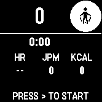
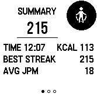
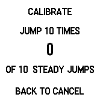

# Jump Rope

A Connect IQ watch app for the Garmin Instinct E 40 mm that counts vertical jumps from wrist motion, tracks sets and rest periods, and records a **Jump Rope** activity.

The app runs entirely on the watch. It does not require a phone connection or network access during a workout.

## Screenshots

| Main | Summary | Calibration |
| --- | --- | --- |
|  |  |  |

Screenshots from the Instinct E 40 mm simulator.

## Features

- Wrist-based vertical jump detection using the accelerometer.
- Adaptive detection threshold with five sensitivity levels.
- Automatic set completion after a configurable rest delay.
- Rest lock with explicit arming: START/Enter/GPS or DOWN.
- Live heart rate, cadence in jumps per minute (JPM), and estimated calories.
- Total or current-set count as the large display value.
- Current streak, best streak, and all-time best records.
- Optional jump target with progress ring and target-reached vibration.
- Optional 3- or 5-second start countdown.
- Vibration-only feedback.
- Per-set history with jumps and active time.
- Light and Dark themes for custom screens.
- Ten-jump custom calibration and live detector diagnostics.
- FIT activity recording with custom session fields.
- Native Garmin menus for settings.

## Device support

| Item | Value |
| --- | --- |
| Device | Garmin Instinct E 40 mm |
| Product ID | `instincte40mm` |
| App type | Watch app |
| Minimum Connect IQ API | 5.1.0 |
| Display | 166 × 166 semioctagon, 1-bit |
| Permissions | `Fit`, `FitContributor`, `Sensor`, `UserProfile` |
| Network access | None |

The project currently targets only `instincte40mm`. Adding another device requires its product ID and layout validation.

## Requirements

- Garmin Instinct E 40 mm.
- Garmin Connect for activity sync.
- Connect IQ SDK 5.1.0 or later to build the app.

## Installation

### Build

```sh
./tools/build.sh
```

Output:

```text
build/JumpRope.prg
```

### Sideload

1. Build the app.
2. Quit Garmin Express.
3. Connect the watch over USB.
4. Remove any older jump-rope `.PRG` from `GARMIN/APPS`.
5. Copy the build to the watch:

   ```sh
   ./tools/install.sh
   ```

   Or copy manually:

   ```text
   build/JumpRope.prg → GARMIN/APPS/JUMPROPE.PRG
   ```

6. Eject the watch safely.
7. Start **Jump Rope** from the watch app list.

## Controls

| Button | Action |
| --- | --- |
| **Enter / GPS** | Start a workout. Pause while running (ignores a press within 1.5 s of a jump). Arm the next set during rest. Save from the summary. |
| **Escape / BACK** | Pause while running. Open the pause menu while paused. Save and return from the summary. Exit from idle. Cancel from a picker or calibration. |
| **UP / MENU** | Open the main menu. Open Discard/Cancel on the summary. Increase a picker value. |
| **DOWN** | Navigate menus and pages. Arm the next set during rest. Decrease a picker value. |
| **UP / DOWN on summary** | Switch between Summary, Details, and History. Scroll the history list. |

The first real jump after arming starts the next set. Arming does not add a set or a jump.

## Screens

### Main

The main screen displays:

- Large jump count.
- Elapsed workout time.
- Heart rate (`HR`).
- Cadence (`JPM`) or last-set average during rest.
- Estimated calories (`KCAL`).
- Current set, streak, and rest timer.
- Target progress ring when a target is configured.
- A jump-rope badge in the top-right corner.

### Rest

When no jump is detected for the configured rest delay, the current set is finalized and counting locks. The rest screen displays the rest timer, last set number and jump count, last-set average cadence, heart rate, and calories.

The middle metric uses `SET AVG` when it fits and falls back to `AVG` on the 166 px display. The value is the last completed set’s average cadence in jumps per minute, not heart rate. If no valid last-set cadence exists, the value is `--`.

Rest does not resume automatically. Arm the next set by pressing START/Enter/GPS or DOWN.

### Summary

The summary has three pages:

1. **Summary** — total jumps, elapsed time, calories, best streak, average cadence, and new-best indicator.
2. **Details** — average and maximum heart rate, peak cadence, sets, and target.
3. **History** — best total, current and best streak, and per-set jumps and active time.

Press Enter/Escape to save, or UP/MENU to discard. If saving fails, the summary displays `SAVE FAILED`.

### Settings

Settings use the native Garmin menu theme. Weight and target values use a custom picker with the app theme.

### Calibration

Calibration is available while idle:

1. Open **UP/MENU > Settings > Calibrate jumps**.
2. Perform ten steady jumps.
3. The app stores a custom threshold based on the measured peaks.

BACK cancels calibration. Changing the sensitivity level or choosing **Clear calibration** restores the default threshold.

### Diagnostics

Diagnostics displays:

- `JMP` — jump count.
- `SIG` — filtered signal.
- `THR` — detection threshold.
- `RAW` — raw acceleration magnitude.
- `PEAK` — peak state.
- `STRK` — current streak.

## Metrics

| Label | Meaning |
| --- | --- |
| `HR` | Heart rate in beats per minute. |
| `JPM` | Current cadence in jumps per minute. |
| `AVG` | Last completed set’s average cadence during rest. |
| `KCAL` | Estimated calories from active time, cadence, and weight. |
| `BEST STREAK` | Longest unbroken jump run in the session. |
| `AVG JPM` | Session average cadence, excluding rest time. |
| `PEAK JPM` | Highest cadence recorded in the session. |
| `SETS` | Number of completed sets. |
| `TARGET` | Configured jump target, or `OFF`. |

## Workout flow

1. Press START/Enter/GPS from idle.
2. If enabled, the start countdown runs before sensors start.
3. Jump normally. Vertical jump peaks increment the count.
4. After the rest delay with no jump, the set is finalized and the app enters rest.
5. Arm the next set with START/Enter/GPS or DOWN.
6. The next real jump starts the set and increments the count.
7. Press BACK while running to pause. The pause menu provides Resume, Save & Finish, and Discard.
8. Save from the summary with Enter/Escape, or discard from the summary menu.

If a set is armed but no jump occurs within the rest delay, the app returns to rest without creating a zero-jump set.

## Settings

Open **UP/MENU > Settings**.

| Setting | Values | Default |
| --- | --- | --- |
| Theme | Light, Dark | Light |
| Sensitivity | 1–5 | 3 |
| Rest delay | 3, 6, 10, 15 seconds | 6 seconds |
| Big number | Total, Current set | Total |
| Start countdown | Off, 3 seconds, 5 seconds | Off |
| Vibrate every | Off, 50, 100, 200, 500 jumps | 100 jumps |
| Heart rate | On, Off | On |
| Save activity | On, Off | On |
| Weight | 30–250 kg, 1 kg steps | Profile weight |
| Target jumps | Off, 50, 100, 200, 300, 500, 750, 1,000, 1,500, 2,000, 2,500, 3,000, 4,000, 5,000, 7,500, 10,000 | Off |
| Calibrate jumps | Ten-jump calibration | Not set |
| Clear calibration | Restores default threshold | — |

Theme, sensitivity, rest delay, big number, countdown, vibration interval, target, and weight apply immediately. Heart rate and save-activity changes apply to the next workout.

## Jump detection

The detector uses the accelerometer at the best available sample rate, normally 50 Hz.

- Gravity is removed with a low-pass filter.
- Slower arm motion is removed with a second filter.
- Acceleration magnitude is smoothed.
- An adaptive threshold is applied to the filtered signal.
- A 220 ms refractory period prevents double-counting one motion.
- A short warm-up period follows start and resume.

The default threshold is:

```text
threshold = 300 - (sensitivity × 34)
```

Sensitivity 3 therefore uses a threshold of 198.

### Rest arming

Rest arming uses horizontal acceleration after gravity removal.

- Three peaks are required within approximately 2.5 seconds.
- Vertical jump-like motion is ignored.
- A short blank period follows arming so the first real jump is not consumed by the arm motion.
- Walking and ordinary arm swing do not arm the next set.

## FIT recording

When activity saving is enabled, the app records:

- Sport `84` (`jump_rope`), with a HIIT fallback.
- Session fields: Jump Count, Best Streak, Avg Cadence, Sets, Avg HR, Max HR.
- Record field: Cadence.
- Lap field: Jump Count, with an attempted `total_cycles` mapping.

Garmin Connect may display the activity as **Jump Rope**. Custom fields remain in the FIT file even when Garmin Connect does not map them to native tiles. Native Total Reps mapping requires verification on a physical watch.

## Privacy

- No network permission.
- No analytics or advertising.
- Settings and best records are stored on the watch.
- Activities are recorded through Garmin’s activity APIs and sync through Garmin Connect.
- The `UserProfile` permission is used only to read the profile weight for the calorie estimate.

Heart rate and calorie values are estimates and are not medical measurements.

## Build and test

```sh
./tools/build.sh
./tools/test.sh
./tools/run.sh
```

`./tools/run.sh` opens the app in the Connect IQ simulator. The simulator cannot inject real wrist motion, so jump detection, optical heart rate, vibration, and saved activity output require a physical watch.

Current unit test coverage:

- Synthetic jump counting.
- Noise rejection.
- Cadence reset across rest gaps.
- Target preset validation.
- FIT session creation, per-set laps, and saving.
- Workout start, pause, resume, stop, and save lifecycle.
- Arm-batch skipping so the rest-to-set button press is not counted.

The suite passes 8 of 8 tests.

## Troubleshooting

### Too many jumps

- Lower Sensitivity to 1 or 2.
- Use Diagnostics to compare `SIG` and `THR` during non-jumping movement.
- Recalibrate with ten steady jumps.

### Missed jumps

- Raise Sensitivity to 4 or 5.
- Check that the watch is snug.
- Use a clear vertical jump motion.
- Recalibrate.

### Rest does not arm

- Press START/Enter/GPS or DOWN to arm the next set.
- Walking and ordinary arm swing are ignored by design.

### `SAVE FAILED`

- Confirm Save activity is on.
- Check watch storage.
- Press Enter to retry.
- Discard from the summary menu if saving continues to fail.

### App not listed on the watch

- Confirm the file is at `GARMIN/APPS/JUMPROPE.PRG`.
- Remove any older jump-rope `.PRG`.
- Confirm the watch is an Instinct E 40 mm.
- Reboot the watch.

### Garmin Connect shows zero Total Reps

The app writes a custom Jump Count field and attempts a native `total_cycles` mapping, but Garmin Connect may ignore it. Check the FIT file and custom fields before concluding the count was lost.

## License

MIT License. See [LICENSE](LICENSE).

Garmin, Instinct, and Connect IQ are trademarks of Garmin Ltd. or its subsidiaries. This project is not affiliated with or endorsed by Garmin.
